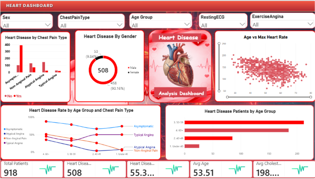

# ❤️ Heart Disease Analysis Dashboard

An interactive dashboard that explores risk patterns in heart disease using clinical data from **918 patients**. It helps you slice the data by demographics and clinical indicators to understand who is most affected and which factors matter most.



> Make sure `he.png` is uploaded in the repository root so the image shows here.

---

## 📌 Project Overview

Heart disease is one of the leading causes of death worldwide. This project turns raw clinical records into visual insights that can support earlier screening and better awareness.

**Objectives**
- Understand how heart disease is distributed across gender, age and chest pain type
- Identify high-risk patient groups
- Provide an interactive way to explore the data through filters

---

## 📊 Key Metrics

| Metric | Value |
|---|---|
| Total Patients | 918 |
| Patients with Heart Disease | 508 |
| Heart Disease Rate | ~55.3% |
| Average Age | 53.51 years |
| Average Cholesterol | ~198 |

---

## 🔍 Key Insights

- **Chest pain type:** Asymptomatic patients account for the largest share of heart disease cases, so the absence of symptoms does not mean the absence of risk.
- **Gender:** Around 90% of heart disease cases are in male patients and about 10% in female patients.
- **Age:** The 50-59 and 60+ age groups have the highest number of patients with heart disease.
- **Max heart rate:** It shows a clear downward trend as age increases.
- **Age and chest pain type:** Heart disease rates vary across age groups depending on the chest pain type.

---

## 🧩 Dashboard Features

- **Interactive filters:** Sex, Chest Pain Type, Age Group, Resting ECG, Exercise Angina
- **Heart Disease by Chest Pain Type:** Bar chart comparing patients with and without heart disease
- **Heart Disease by Gender:** Donut chart showing the male/female split
- **Age vs Max Heart Rate:** Scatter plot showing the relationship between age and peak heart rate
- **Heart Disease Rate by Age Group and Chest Pain Type:** Line chart showing how the rate changes across age groups
- **Heart Disease Patients by Age Group:** Bar chart of affected patients per age group
- **KPI cards:** Total patients, heart disease cases, disease rate, average age, average cholesterol

---

## 🛠️ Tools & Technologies

- Power BI (dashboard and visualization)
- DAX (measures and calculations)
- Power Query (data cleaning and transformation)

<!-- Update this list if you used different tools, e.g. Excel, SQL, Python. -->

---

## 📁 Dataset

- **Records:** 918 patients
- **Source:** `<add dataset link here, e.g. Kaggle / UCI>`
- **Features include:** Age, Sex, ChestPainType, RestingECG, MaxHR, ExerciseAngina, Cholesterol, HeartDisease (target)

---

## 📂 Repository Structure

```
├── README.md
├── he.png                 # Dashboard screenshot
├── HeartDisease.pbix      # Power BI file
└── data/
    └── heart.csv          # Dataset
```

<!-- Adjust the file names to match your repository. -->

---

## 🚀 How to Use

1. Clone the repository
   ```bash
   git clone https://github.com/<your-username>/<repo-name>.git
   ```
2. Open `HeartDisease.pbix` in **Power BI Desktop**
3. If prompted, point the data source to `data/heart.csv`
4. Use the filters at the top to explore the data

---

## 📈 Future Improvements

- Add cholesterol and blood pressure analysis
- Build a predictive model for heart disease risk
- Add a comparison view between patient groups

---

## 👤 Author

**Your Name**
- LinkedIn: `<your-linkedin-url>`
- GitHub: `<your-github-profile>`

---

## ⚠️ Disclaimer

This project is for educational and analytical purposes only. It is not intended for medical diagnosis or treatment decisions.

---

⭐ If you found this project useful, consider giving it a star!
